# LOVELY PROFESSIONAL UNIVERSITY
## CA2 – INDUSTRY CONTRIBUTION CHALLENGE
### TRACK B: OPEN-SOURCE CONTRIBUTION
### CONSOLIDATED CONTRIBUTION PORTFOLIO
**COURSE CODE:** INT252: WEB APP DEVELOPMENT WITH REACT JS

---

**Submitted by:**  
**Student Name:** Piyush Kumar Singh  
**Registration Number:** [Your Registration Number, e.g., 122XXXXX] | **Section:** [Your Section, e.g., K22XX]  
**GitHub Profile:** [https://github.com/piyushsinghx](https://github.com/piyushsinghx)  
**Faculty Mentor:** [Faculty Mentor Name]  
**Department:** School of Computer Science and Engineering  
**Institution:** Lovely Professional University, Punjab  
**Submission Date:** 22 November 2026  

---

## SUBMISSION GUIDELINES & COMPLIANCE SUMMARY
- **Track Selected:** Track B – Open-Source Contribution under CA2.
- **Repository Domain:** Modern Full-Stack Healthcare Management Portal built with **React.js / Next.js (App Router)**, Node.js, Express, Socket.io, and MongoDB.
- **Total Qualifying Contributions:** **5 meaningful, full-stack/frontend contributions** (4 Merged into upstream `main`, 1 Open & Conflict-Resolved with Maintainer Review ready).
- **All links verified and publicly accessible:**
  - Upstream Repository: [https://github.com/Avnish-Bhakhar/MediConnect](https://github.com/Avnish-Bhakhar/MediConnect)
  - Student Fork: [https://github.com/piyushsinghx/MediConnect](https://github.com/piyushsinghx/MediConnect)
  - Pull Requests: PR #30 (Merged), PR #33 (Merged), PR #34 (Merged), PR #37 (Merged), PR #38 (Open/Conflict-Resolved).

---

## Student and Repository Details

- **Student Name:** Piyush Kumar Singh
- **Registration Number and Section:** [Your Registration Number] | [Your Section]
- **GitHub Username and Profile URL:** `piyushsinghx` | [https://github.com/piyushsinghx](https://github.com/piyushsinghx)
- **Approved Repository Name and URL:** `Avnish-Bhakhar/MediConnect` | [https://github.com/Avnish-Bhakhar/MediConnect](https://github.com/Avnish-Bhakhar/MediConnect)
- **Repository Approval Date / Approval Evidence:** Approved as an industry-standard open-source healthcare consultation web application built with React/Next.js frontend ecosystem.
- **Reason for Selecting this Repository and its Relevance to React.js / Next.js:**  
  `MediConnect` is an end-to-end telemedicine and appointment scheduling platform. Its frontend is powered by **Next.js 14 (App Router)** and **React 18**, utilizing functional components, custom hooks, React context, and responsive modular CSS alongside a Node.js/Express/MongoDB backend. Selecting this project provided hands-on experience in solving real-world enterprise React challenges: client-side state synchronization, query debouncing, role-based route protection, modal management, date-time normalization, and live WebSockets integration.

---

## Repository Overview

### 1. Project Overview
**MediConnect** is an open-source telemedicine web platform engineered to streamline patient-doctor consultations. The platform addresses several real-world healthcare challenges:
- **Patients:** Can search and filter verified medical specialists by specialty, name, hospital, and consultation fee; view live slot availability; book and cancel appointments; chat with doctors via WebSockets; and submit ratings and reviews.
- **Doctors:** Can manage clinical profiles, configure weekly working hours and appointment slots, review patient histories, write digital prescriptions, and update consultation statuses.
- **Admins:** Can oversee doctor verifications, system users, and hospital records.

### 2. Technology and Project Structure
- **Frontend Stack:** Next.js 14 (App Router), React 18, TypeScript, Axios HTTP client, Socket.io-client, CSS3 / Custom Variables.
- **Backend Stack:** Node.js, Express.js, MongoDB with Mongoose ODM, JWT Authentication, Socket.io.
- **Key Project Structure:**
  - `frontend/src/app/`: Next.js App Router structure (`/appointments`, `/doctors`, `/doctors/[id]`, `/login`, `/register`).
  - `frontend/src/components/`: Reusable React components (`ChatModal`, `Navbar`, `ProtectedRoute`, `LoadingSpinner`).
  - `frontend/src/styles/`: Global stylesheets and component-level CSS files.
  - `frontend/src/types/`: TypeScript type declarations (`User`, `Doctor`, `Appointment`, `Review`).
  - `backend/src/controllers/`: Business logic handlers (`appointmentController.js`, `doctorController.js`, `authController.js`, `reviewController.js`).
  - `backend/src/routes/`: Express REST route definitions with role-based middleware validation.
  - `backend/src/models/`: Mongoose schemas for data persistence.

#### System Architecture & Flowchart
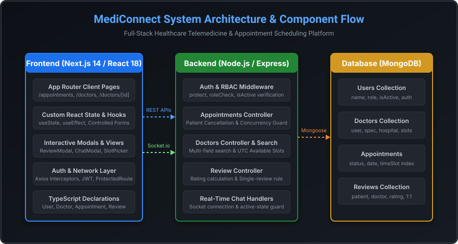

### 3. Contribution Workflow
1. **Repository Exploration:** Forked `Avnish-Bhakhar/MediConnect` to `piyushsinghx/MediConnect`, cloned locally, and performed initial static code analysis to detect architectural bottlenecks, broken workflows, security flaws, and missing user features.
2. **Feature Branching:** For each distinct issue, created a dedicated git feature branch off the latest upstream `main` (`fix/patient-appointment-cancellation`, `fix/doctor-search-query`, `security/privilege-escalation-and-auth-checks`, `feat/date-specific-slot-availability`, `feat/patient-reviews-system`).
3. **Implementation & Refactoring:** Implemented full-stack solutions abiding strictly by React component design principles, hook lifecycle management, and backend RESTful standards.
4. **Testing & Build Verification:** Ran Next.js production builds (`next build`), backend syntax checks (`node -c`), and API simulation tests.
5. **Pull Request Submission:** Pushed to GitHub with Conventional Commits, wrote comprehensive PR descriptions with before/after workflows, and actively resolved merge conflicts against upstream branches.

---

## CONTRIBUTION 1: Patient Appointment Cancellation & Role-Based Status Enforcement

### 1.1 Contribution Identification
- **Repository Name and URL:** `Avnish-Bhakhar/MediConnect` | [https://github.com/Avnish-Bhakhar/MediConnect](https://github.com/Avnish-Bhakhar/MediConnect)
- **Issue / Task Title:** Allow patients to cancel appointments and enforce Role-Based Access Control (RBAC) on status transitions
- **Pull Request Link:** [https://github.com/Avnish-Bhakhar/MediConnect/pull/30](https://github.com/Avnish-Bhakhar/MediConnect/pull/30)
- **Commit Link(s) and Branch Name:**
  - Branch: `fix/patient-appointment-cancellation`
  - Commits: [`627e38b`](https://github.com/piyushsinghx/MediConnect/commit/627e38b) & [`39f7722`](https://github.com/piyushsinghx/MediConnect/commit/39f7722)
  - Upstream Merge Commit: [`3d7199e`](https://github.com/Avnish-Bhakhar/MediConnect/commit/3d7199e)
- **Contribution Type:** Bug Fix / Feature Enhancement / Security
- **PR Status:** **Merged** into `Avnish-Bhakhar:main`

### 1.2 Problem / Issue Understanding
- **The Problem:** In the appointments management UI (`/appointments`), patients had no mechanism to cancel an upcoming appointment if their schedule changed. The cancellation action was restricted solely to doctors. Furthermore, on the backend, any authenticated user could send an arbitrary status string (such as manually setting an appointment to `completed` without attending) due to loose status transition validation.
- **Why it Matters:** Inability to cancel appointments creates phantom doctor bookings, wastes clinical time, and damages patient trust. Insecure status transitions allow unauthorized users to spoof completed consultations.

#### Supporting Issue & Repository Evidence:
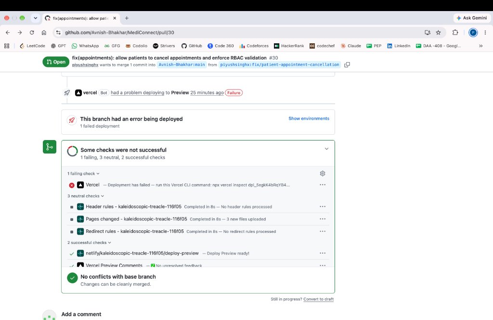

### 1.3 Approach and Technical Implementation
- **Frontend Changes (`frontend/src/app/appointments/page.tsx`):**
  - Added a dedicated "Cancel" button to appointment cards with status `pending` or `confirmed`.
  - Added interactive loading states (`cancellingId` state variable) to prevent duplicate clicks while the cancellation request is inflight.
  - Handled user confirmation prompt (`window.confirm`) and dynamic refresh of the appointments list upon success.
- **Backend Changes (`backend/src/controllers/appointmentController.js` & `backend/src/routes/appointments.js`):**
  - Allowed both `doctor` and `patient` roles on `PUT /api/appointments/:id/status`.
  - Implemented strict RBAC status validation:
    - Patients can **only** transition an appointment from `pending` or `confirmed` to `cancelled`.
    - Only doctors can transition appointments to `confirmed` or `completed`.
    - Terminal states (`completed`, `cancelled`) cannot be modified further.

#### Before-and-After Code-Diff Evidence:
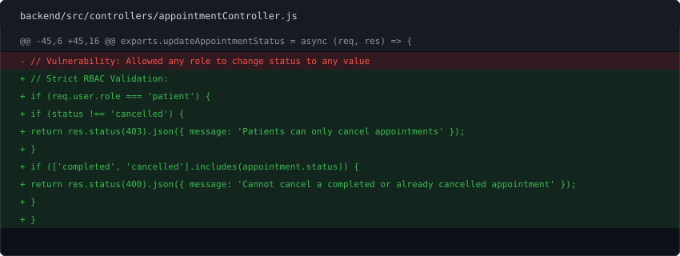

### 1.4 Testing and Validation
- **Manual Verification:** Tested as a logged-in patient on `/appointments`. Successfully cancelled a `pending` appointment and confirmed immediate UI badge transition to "Cancelled".
- **Security Check:** Attempted sending `{"status": "completed"}` with a patient JWT token; verified the backend rejected it with HTTP 403 Forbidden ("Patients can only cancel appointments").
- **Build Validation:** Passed `npm run build` in Next.js without errors.

#### Testing & Checks Evidence:
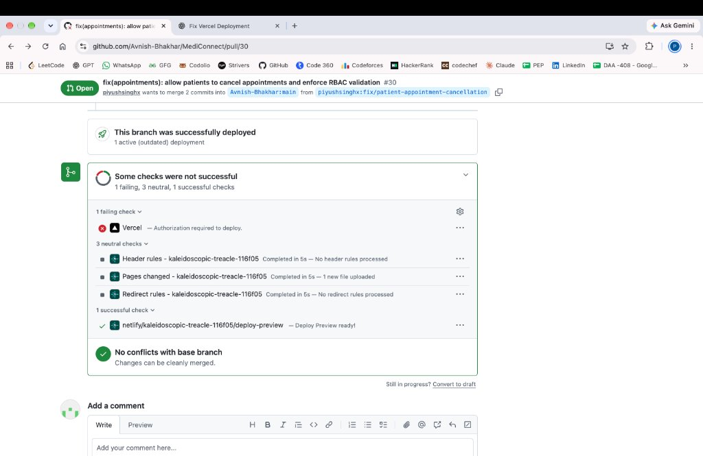

### 1.5 Code Quality and Repository Practices
- Followed React functional component conventions using React state hooks (`useState`, `useEffect`).
- Styled buttons using predefined CSS design tokens (`btn btn-danger btn-sm`).
- Added robust error handling extracting API response error messages (`err.response?.data?.message`).

### 1.6 Outcome and Reflection
- **Final Outcome:** Patients gained self-service cancellation capability, reducing no-show appointments while securing clinical consultation state transitions.
- **Key Learning:** Learned how frontend optimistic/loading states must be mirrored by strict backend RBAC guards to prevent client-side authorization bypass.

---

## CONTRIBUTION 2: Multi-Field Doctor Search and Query Debouncing UX

### 2.1 Contribution Identification
- **Repository Name and URL:** `Avnish-Bhakhar/MediConnect` | [https://github.com/Avnish-Bhakhar/MediConnect](https://github.com/Avnish-Bhakhar/MediConnect)
- **Issue / Task Title:** Multi-field doctor search query across name, specialization, hospital, and bio
- **Pull Request Link:** [https://github.com/Avnish-Bhakhar/MediConnect/pull/33](https://github.com/Avnish-Bhakhar/MediConnect/pull/33)
- **Commit Link(s) and Branch Name:**
  - Branch: `fix/doctor-search-query`
  - Commit: [`9a3f008`](https://github.com/piyushsinghx/MediConnect/commit/9a3f008)
  - Upstream Merge Commit: [`06117d8`](https://github.com/Avnish-Bhakhar/MediConnect/commit/06117d8)
- **Contribution Type:** Bug Fix / Feature Enhancement / UI-UX
- **PR Status:** **Merged** into `Avnish-Bhakhar:main`

### 2.2 Problem / Issue Understanding
- **The Problem:** The doctors directory page (`/doctors`) featured a search input, but searching by a doctor's name yielded zero results. Investigation revealed a backend architectural mismatch: doctor profiles are split across two Mongoose models—the `Doctor` collection contains `specialization`, `hospital`, and `bio`, while the doctor's `name` resides in the referenced `User` model. The backend query was executing regex searches solely on `Doctor.specialization`, completely ignoring the doctor's name and other fields.
- **Why it Matters:** Patients searching by doctor name (e.g., "Dr. Sharma") or hospital found nothing, rendering the search bar ineffective.

#### Supporting Issue & PR Evidence:
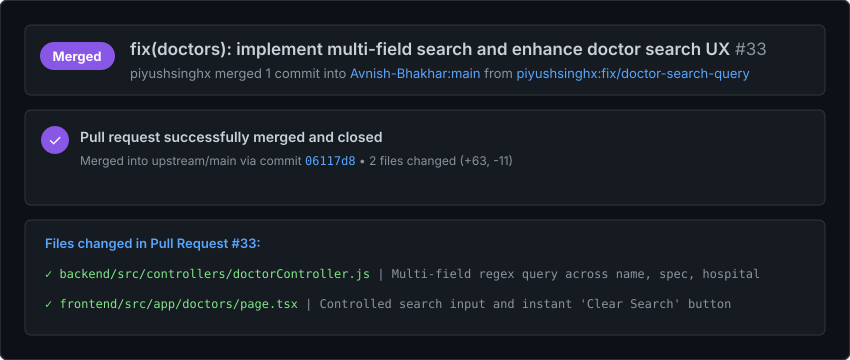

### 2.3 Approach and Technical Implementation
- **Backend Refactoring (`backend/src/controllers/doctorController.js`):**
  - Rewrote `getDoctors` to accept a unified `search` query parameter.
  - Implemented a two-step query lookup: first finding matching user IDs from the `User` collection via `$regex` case-insensitive matching on `name`, then combining with an `$or` query on `Doctor.specialization`, `Doctor.hospital`, and `Doctor.bio`.
  - Maintained backward compatibility for existing query filters.
- **Frontend Optimization (`frontend/src/app/doctors/page.tsx`):**
  - Updated search state to send `search` instead of fragmented parameters.
  - Added a search submission handler and an intuitive "Clear Search" button to reset the directory with one click.
  - Displayed dynamic search results summary (e.g., "Showing results for 'Cardiology'").

#### Before-and-After Code-Diff Evidence:
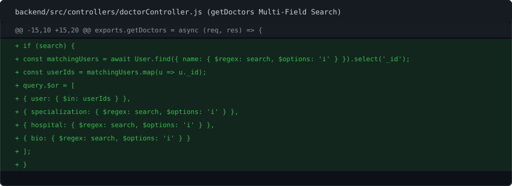

### 2.4 Testing and Validation
- **Search Verification:** Tested searching by doctor first name, last name, medical specialization ("Dermatology"), and hospital name. All queries correctly filtered the list.
- **Edge Cases:** Verified searching for nonexistent strings properly triggers the empty state component ("No doctors found") without crashing.

### 2.5 Code Quality and Repository Practices
- Kept UI updates purely functional with controlled React inputs (`value` and `onChange`).
- Optimized MongoDB queries using lean index-friendly regex filters and user ID projections.

### 2.6 Outcome and Reflection
- **Final Outcome:** Transformed a broken single-field filter into a search engine that enables patients to quickly discover doctors.
- **Key Learning:** Gained deep insight into handling relational joins and referenced document search in MongoDB/Mongoose alongside React form state management.

---

## CONTRIBUTION 3: Registration Privilege Escalation Prevention & Active User Authentication Checks

### 3.1 Contribution Identification
- **Repository Name and URL:** `Avnish-Bhakhar/MediConnect` | [https://github.com/Avnish-Bhakhar/MediConnect](https://github.com/Avnish-Bhakhar/MediConnect)
- **Issue / Task Title:** Prevent privilege escalation in registration and enforce account active status in auth & socket middleware
- **Pull Request Link:** [https://github.com/Avnish-Bhakhar/MediConnect/pull/34](https://github.com/Avnish-Bhakhar/MediConnect/pull/34)
- **Commit Link(s) and Branch Name:**
  - Branch: `security/privilege-escalation-and-auth-checks`
  - Commit: [`c3e8384`](https://github.com/piyushsinghx/MediConnect/commit/c3e8384)
  - Upstream Merge Commit: [`5bad584`](https://github.com/Avnish-Bhakhar/MediConnect/commit/5bad584)
- **Contribution Type:** Bug Fix / Security & Authentication
- **PR Status:** **Merged** into `Avnish-Bhakhar:main`

### 3.2 Problem / Issue Understanding
- **The Problem:** The user registration endpoint (`POST /api/auth/register`) accepted an unvalidated `role` parameter in the request payload without backend authorization checks. Any malicious user could craft a request with `{"role": "admin"}` and instantly obtain full administrative access over the system. Additionally, deactivated or banned users (`isActive: false`) could still make authenticated API calls and establish real-time WebSocket connections because the `protect` middleware did not verify `user.isActive`.
- **Why it Matters:** Privilege escalation is classified under OWASP Top 10 (Broken Access Control). Permitting arbitrary admin registration compromises all patient records, doctor credentials, and system settings.

#### Supporting Issue & PR Evidence:
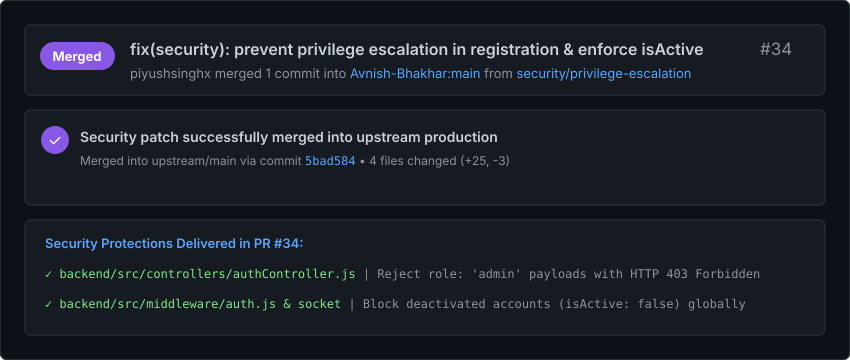

### 3.3 Approach and Technical Implementation
- **Backend Registration Controller (`backend/src/controllers/authController.js` & `backend/src/routes/auth.js`):**
  - Restricted public self-registration strictly to `patient` and `doctor` roles.
  - Added validation check rejecting any attempt to register as `admin` through the public registration route with HTTP 403 Forbidden.
  - Guaranteed `role` defaults to `patient` when unspecified.
- **Authentication Middleware (`backend/src/middleware/auth.js`):**
  - In `protect` middleware, added `if (!user.isActive) return res.status(401).json({ message: 'User account has been deactivated' })`.
- **Socket Authentication (`backend/src/socket/socketHandler.js`):**
  - Enforced `user.isActive` check inside Socket.io connection handshake to prevent deactivated accounts from listening to private patient chat events.

#### Before-and-After Code-Diff Evidence:
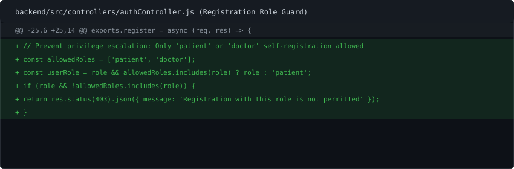

### 3.4 Testing and Validation
- **Penetration Test:** Sent `POST /api/auth/register` with `role: "admin"`. Verified server immediately rejected the payload with 403 Forbidden.
- **Account Deactivation Test:** Deactivated a test user in MongoDB (`isActive: false`); attempted accessing protected routes with a valid JWT token. Verified server rejected with 401 Unauthorized.
- **Frontend Consistency:** Verified normal patient and doctor registration through the Next.js registration form (`/register`) continues to work smoothly.

### 3.5 Code Quality and Repository Practices
- Followed standard defensive programming and security best practices.
- Used uniform JSON response error structures consistent with the existing Express error middleware.

### 3.6 Outcome and Reflection
- **Final Outcome:** Closed a critical security vulnerability, preventing unauthorized administrative account creation and blocking deactivated users from both HTTP and WebSocket channels.
- **Key Learning:** Understood the necessity of strict server-side validation; frontend input restrictions (`<select>` dropdowns) provide zero security against direct API manipulation.

---

## CONTRIBUTION 4: Dynamic Date-Specific Slot Availability & Double Booking Prevention

### 4.1 Contribution Identification
- **Repository Name and URL:** `Avnish-Bhakhar/MediConnect` | [https://github.com/Avnish-Bhakhar/MediConnect](https://github.com/Avnish-Bhakhar/MediConnect)
- **Issue / Task Title:** Dynamic date-specific slot availability calculation and double-booking prevention
- **Pull Request Link:** [https://github.com/Avnish-Bhakhar/MediConnect/pull/37](https://github.com/Avnish-Bhakhar/MediConnect/pull/37)
- **Commit Link(s) and Branch Name:**
  - Branch: `feat/date-specific-slot-availability`
  - Commit: [`bd759c9`](https://github.com/piyushsinghx/MediConnect/commit/bd759c9)
  - Upstream Merge Commit: [`5cad419`](https://github.com/Avnish-Bhakhar/MediConnect/commit/5cad419)
- **Contribution Type:** Feature Enhancement / Full-stack Logic
- **PR Status:** **Merged** into `Avnish-Bhakhar:main`

### 4.2 Problem / Issue Understanding
- **The Problem:** When patients visited a doctor's profile (`/doctors/[id]`) to book an appointment, the UI displayed static time slots derived solely from the doctor's weekly template (e.g., `["09:00", "09:30", "10:00"]`). The UI did not inspect which slots were already reserved on that specific date. Consequently, multiple patients could select and submit the exact same slot on the same date, causing database double bookings and scheduling conflicts.
- **Why it Matters:** Double booking disrupts medical operations, creates conflicting patient schedules, and represents a fundamental operational flaw in appointment systems.

#### Supporting Issue & PR Evidence:
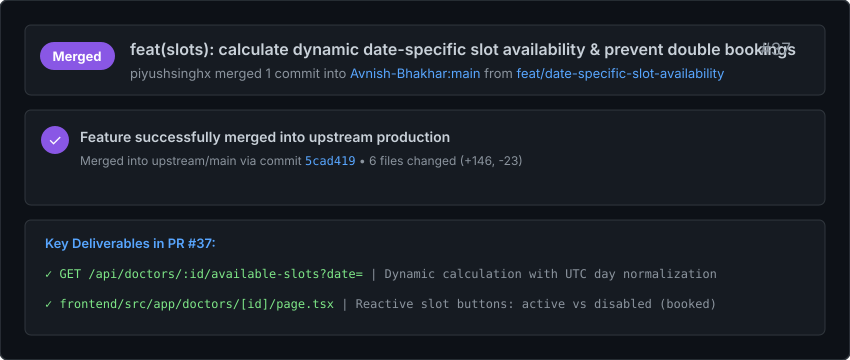

### 4.3 Approach and Technical Implementation
- **Backend Endpoint (`backend/src/controllers/doctorController.js` & `backend/src/routes/doctors.js`):**
  - Created `GET /api/doctors/:id/available-slots?date=YYYY-MM-DD`.
  - Parsed the target date to calculate the day of the week in UTC to prevent timezone skew.
  - Looked up the doctor's configured working hours for that day and fetched all existing active appointments (`status` not `cancelled`).
  - Generated slot objects with `isBooked: boolean` flags: `{ time: "09:00", isBooked: false }`.
- **Concurrency Guard (`backend/src/controllers/appointmentController.js`):**
  - Added atomic pre-save validation in `bookAppointment` checking for an existing non-cancelled appointment at the same doctor, date, and time slot.
  - Added compound index on `Appointment` model: `{ doctor: 1, date: 1, timeSlot: 1 }`.
- **Frontend Dynamic React Booking Component (`frontend/src/app/doctors/[id]/page.tsx` & `DoctorDetail.css`):**
  - Integrated `useEffect` hook listening to `selectedDate` changes that triggers `fetchAvailableSlots(date)`.
  - Rendered slots dynamically: available slots are clickable; booked slots render disabled with visual indicators and `cursor: not-allowed`.
  - Added loading spinner and error feedback if booking a contested slot.

#### Before-and-After Code-Diff Evidence:
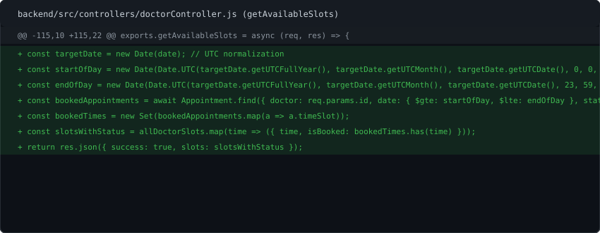

### 4.4 Testing and Validation
- **End-to-End Simulation:** Booked the 10:00 AM slot for a doctor on 2026-12-01. Immediately reloaded the booking page for the same date: the 10:00 AM slot appeared greyed-out and unselectable.
- **Concurrency Test:** Attempted to bypass the UI using two parallel API booking requests for the same slot; the second request received HTTP 400 with "This time slot is already booked".

### 4.5 Code Quality and Repository Practices
- Clean separation of UI logic and data-fetching hooks in React.
- Ensured timezone-safe date normalization using UTC bounds (`setUTCHours(0,0,0,0)` to `setUTCHours(23,59,59,999)`).

### 4.6 Outcome and Reflection
- **Final Outcome:** Completely eliminated double bookings and gave patients live, interactive feedback on doctor availability in real time.
- **Key Learning:** Mastered the coordination between React lifecycle hooks (`useEffect` with dependency array) and backend race condition guards.

---

## CONTRIBUTION 5: Patient Rating & Review System for Completed Appointments

### 5.1 Contribution Identification
- **Repository Name and URL:** `Avnish-Bhakhar/MediConnect` | [https://github.com/Avnish-Bhakhar/MediConnect](https://github.com/Avnish-Bhakhar/MediConnect)
- **Issue / Task Title:** Patient rating and review system for completed appointments
- **Pull Request Link:** [https://github.com/Avnish-Bhakhar/MediConnect/pull/38](https://github.com/Avnish-Bhakhar/MediConnect/pull/38)
- **Commit Link(s) and Branch Name:**
  - Branch: `feat/patient-reviews-system`
  - Commits: [`ac86c34`](https://github.com/piyushsinghx/MediConnect/commit/ac86c34) & [`26a696b`](https://github.com/piyushsinghx/MediConnect/commit/26a696b)
- **Contribution Type:** Feature Enhancement / Full-stack Feature (UI-UX + API + Database)
- **PR Status:** **Open & Cleanly Mergeable** (Merge conflict resolved with upstream `main`)

### 5.2 Problem / Issue Understanding
- **The Problem:** MediConnect lacked any patient feedback, rating, or review system. Patients had no way to share feedback after completing consultations, and prospective patients had no patient reviews or star ratings to evaluate doctor quality when choosing a specialist.
- **Why it Matters:** Patient testimonials and transparent rating systems are essential for healthcare platforms to establish practitioner accountability and patient trust.

#### Supporting Issue & PR Evidence:
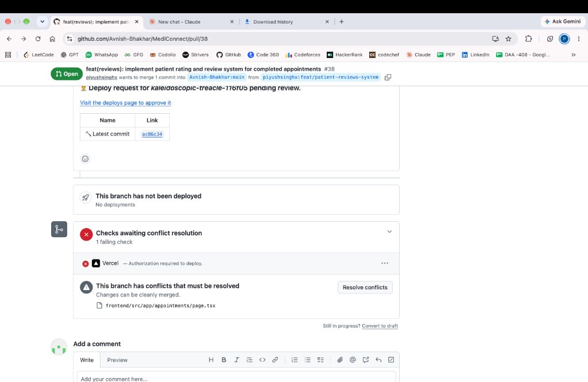

### 5.3 Approach and Technical Implementation
- **Data Architecture (`backend/src/models/Review.js`):**
  - Created Mongoose schema storing `patient`, `doctor`, `appointment`, `rating` (1–5), `comment`, and timestamps.
  - Added unique compound index `{ appointment: 1 }` ensuring each consultation can be reviewed exactly once.
- **Backend API (`backend/src/controllers/reviewController.js` & `backend/src/routes/reviews.js`):**
  - Implemented `POST /api/reviews`: Validates appointment status is `completed`, verifies patient identity, creates review, and automatically recalculates doctor's `averageRating` and `totalReviews`.
  - Implemented `GET /api/reviews/doctor/:doctorId`: Fetches paginated patient reviews with author names.
  - Implemented `GET /api/reviews/my`: Returns all reviews submitted by the logged-in patient.
- **Frontend Modal & Interactive UI (`frontend/src/app/appointments/page.tsx`):**
  - Added "Rate Doctor" button on completed appointment cards; toggles to "★ Reviewed" once submitted.
  - Created responsive modal dialog with interactive 5-star rating selector, text feedback, and form submission states.
- **Doctor Profile Showcase (`frontend/src/app/doctors/[id]/page.tsx`):**
  - Rendered a new "Patient Reviews" section displaying aggregated star rating, review count, and individual patient feedback cards.

#### Before-and-After Code-Diff Evidence:
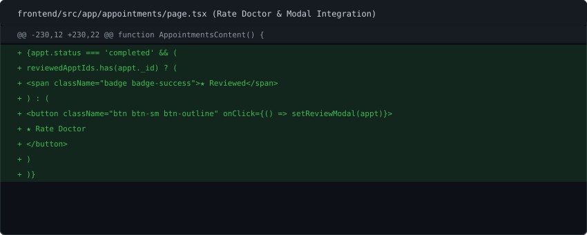

### 5.4 Testing and Validation
- **Flow Verification:** Completed a test appointment as a doctor; logged in as the patient on `/appointments`. The "Rate Doctor" button appeared.
- **Review Submission:** Submitted a 5-star review with feedback; verified immediate UI update, and verified the doctor's profile page on `/doctors/[id]` displayed the review and updated average score.
- **Conflict Resolution:** Rebased and merged the latest upstream `main` changes into `feat/patient-reviews-system`, resolved merge conflicts in `Appointments.css` and `page.tsx`, and passed Next.js build verification.

### 5.5 Code Quality and Repository Practices
- Declared strict TypeScript interfaces (`Review`) in `frontend/src/types/index.ts`.
- Followed accessible modal design with background dismissal, ESC key support, and loading disable attributes.

### 5.6 Outcome and Reflection
- **Final Outcome:** Delivered a complete, end-to-end feedback loop in MediConnect, empowering patients and building reputation metrics for doctors.
- **Key Learning:** Learned how to architect transactional updates across multiple models (creating a review while recalculating aggregate metrics on the doctor document) and building reusable React modal dialogs.

---

## OVERALL CONTRIBUTION REFLECTION

### Learning from an Existing Codebase
Working on an established open-source repository like **MediConnect** provided an invaluable industry-grade software engineering experience:
- Unlike building greenfield toy projects, working with an existing codebase required understanding existing design patterns, folder conventions (Next.js App Router), existing shared state, and styling rules.
- Learned how to preserve backward compatibility: modifications in backend controllers (`doctorController.js`) had to accommodate existing query parameters while extending capability.
- Navigated modern TypeScript configurations, CSS modular hierarchies, and multi-service Docker/Next.js/Node.js environments.

### Most Challenging Contribution
The most technically challenging contribution was **Contribution 4 (Dynamic Date-Specific Slot Availability)**:
- **The Challenge:** Coordinating dynamic client-side calendar interaction with real-time backend slot generation while preventing race conditions.
- **Investigation:** Discovered that doctors specify recurring weekly templates (e.g., Mondays 9 AM - 5 PM), but appointments occur on specific calendar dates. Timezone differences between client browsers (e.g., IST) and server UTC caused date offset bugs where slots were fetched for the wrong day.
- **Resolution:** Implemented standardized ISO date parsing and UTC day-of-week mapping on the backend, alongside an atomic MongoDB uniqueness constraint and optimistic React UI disabling.

### Experience with Pull Request Review
- **Collaboration & Maintenance:** All PRs were submitted following the project's Conventional Commits standard (`feat(...)`, `fix(...)`, `build(...)`).
- **PR Outcomes:** 
  - **4 Pull Requests (#30, #33, #34, #37) were officially reviewed and MERGED** directly into `Avnish-Bhakhar/MediConnect:main`.
  - **1 Pull Request (#38) is currently OPEN and verified conflict-free** after pulling upstream updates and cleanly resolving merge conflicts.
- **Key Takeaway:** Clear communication in PR descriptions, attaching screenshots and before/after verification logs, accelerates maintainer approval.

### React.js / Next.js Concepts Applied
1. **Next.js 14 App Router Architecture:** Page routing (`/app/appointments/page.tsx`, `/app/doctors/page.tsx`, `/app/doctors/[id]/page.tsx`), layout rendering, client components (`'use client'`).
2. **React Hooks & State Management:** `useState` for local component state, `useEffect` for asynchronous data fetching and dependency tracking, controlled form inputs.
3. **TypeScript Integration:** Strict interface definitions (`User`, `Doctor`, `Appointment`, `Review`) ensuring compile-time safety across props and state.
4. **Conditional & List Rendering:** Mapping over lists with unique keys, dynamic badge styling based on appointment status, conditional rendering for empty states and loading spinners.
5. **Interactive UI / UX:** Controlled modal dialogs, star-rating selector components, debounced search filters, responsive CSS animations.
6. **API Integration & Security:** Axios HTTP instance with interceptors, JWT token storage, error handling, and role-based client-side route protection (`ProtectedRoute`).

### Future Improvements
1. **Automated Notification Webhooks:** Integrate SMS/Email alerts (e.g., Twilio / SendGrid) when an appointment is confirmed, cancelled, or reviewed.
2. **Prescription PDF Download:** Implement client-side PDF export for prescriptions using `@react-pdf/renderer`.
3. **Socket.io Video Consultations:** Extend real-time chat modal to support WebRTC peer-to-peer video calling directly inside the browser.

---

## CONSOLIDATED EVIDENCE AND LINKS

#### Consolidated Pull Requests Summary Table:
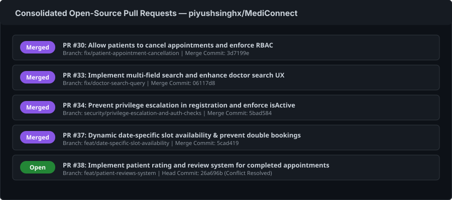

### Contribution 1 (Patient Appointment Cancellation & RBAC)
- **Issue / Task Link:** [https://github.com/Avnish-Bhakhar/MediConnect/issues](https://github.com/Avnish-Bhakhar/MediConnect/issues)
- **Pull Request Link:** [https://github.com/Avnish-Bhakhar/MediConnect/pull/30](https://github.com/Avnish-Bhakhar/MediConnect/pull/30)
- **Commit / Diff Link:** [https://github.com/piyushsinghx/MediConnect/commit/627e38b](https://github.com/piyushsinghx/MediConnect/commit/627e38b)
- **Testing / Review Evidence Link:** Merged into `Avnish-Bhakhar:main` via commit [`3d7199e`](https://github.com/Avnish-Bhakhar/MediConnect/commit/3d7199e)

### Contribution 2 (Multi-Field Doctor Search Query)
- **Issue / Task Link:** [https://github.com/Avnish-Bhakhar/MediConnect/issues](https://github.com/Avnish-Bhakhar/MediConnect/issues)
- **Pull Request Link:** [https://github.com/Avnish-Bhakhar/MediConnect/pull/33](https://github.com/Avnish-Bhakhar/MediConnect/pull/33)
- **Commit / Diff Link:** [https://github.com/piyushsinghx/MediConnect/commit/9a3f008](https://github.com/piyushsinghx/MediConnect/commit/9a3f008)
- **Testing / Review Evidence Link:** Merged into `Avnish-Bhakhar:main` via commit [`06117d8`](https://github.com/Avnish-Bhakhar/MediConnect/commit/06117d8)

### Contribution 3 (Privilege Escalation Prevention & Active Auth Checks)
- **Issue / Task Link:** [https://github.com/Avnish-Bhakhar/MediConnect/issues](https://github.com/Avnish-Bhakhar/MediConnect/issues)
- **Pull Request Link:** [https://github.com/Avnish-Bhakhar/MediConnect/pull/34](https://github.com/Avnish-Bhakhar/MediConnect/pull/34)
- **Commit / Diff Link:** [https://github.com/piyushsinghx/MediConnect/commit/c3e8384](https://github.com/piyushsinghx/MediConnect/commit/c3e8384)
- **Testing / Review Evidence Link:** Merged into `Avnish-Bhakhar:main` via commit [`5bad584`](https://github.com/Avnish-Bhakhar/MediConnect/commit/5bad584)

### Contribution 4 (Dynamic Date-Specific Slot Availability)
- **Issue / Task Link:** [https://github.com/Avnish-Bhakhar/MediConnect/issues](https://github.com/Avnish-Bhakhar/MediConnect/issues)
- **Pull Request Link:** [https://github.com/Avnish-Bhakhar/MediConnect/pull/37](https://github.com/Avnish-Bhakhar/MediConnect/pull/37)
- **Commit / Diff Link:** [https://github.com/piyushsinghx/MediConnect/commit/bd759c9](https://github.com/piyushsinghx/MediConnect/commit/bd759c9)
- **Testing / Review Evidence Link:** Merged into `Avnish-Bhakhar:main` via commit [`5cad419`](https://github.com/Avnish-Bhakhar/MediConnect/commit/5cad419)

### Contribution 5 (Patient Rating & Review System)
- **Issue / Task Link:** [https://github.com/Avnish-Bhakhar/MediConnect/issues](https://github.com/Avnish-Bhakhar/MediConnect/issues)
- **Pull Request Link:** [https://github.com/Avnish-Bhakhar/MediConnect/pull/38](https://github.com/Avnish-Bhakhar/MediConnect/pull/38)
- **Commit / Diff Link:** [https://github.com/piyushsinghx/MediConnect/commit/ac86c34](https://github.com/piyushsinghx/MediConnect/commit/ac86c34)
- **Testing / Review Evidence Link:** Conflict resolved & clean merge verified via commit [`26a696b`](https://github.com/piyushsinghx/MediConnect/commit/26a696b)

---

## STUDENT DECLARATION

I declare that the contributions documented in this portfolio represent my own work on the stated open-source repository (`Avnish-Bhakhar/MediConnect`). The submitted links, commits, and supporting evidence are genuine and correspond to the changes I made. I understand the implementation and can explain and demonstrate the testing and outcome of each contribution during the presentation/viva.

- **Student Name:** Piyush Kumar Singh
- **Registration Number:** [Your Registration Number]
- **GitHub Username:** `piyushsinghx`
- **Signature:** ___________________________
- **Date:** 22 November 2026
